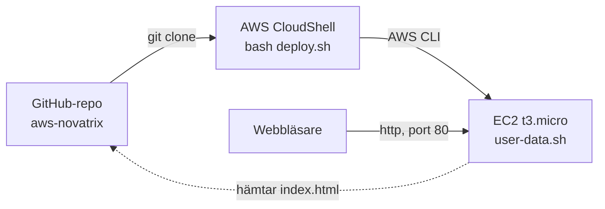
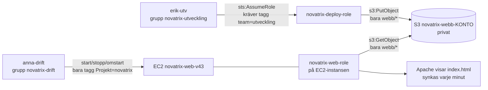

# AWS-miljö från kod – Novatrix webbplats i AWS

Kursprojekt där företaget **Novatrix AB** flyttar sin webbplats till AWS. En mapp per vecka, och varje vecka bygger vidare på samma miljö. Allt skapas och rivs med skript från repot, utan klick i konsolen.

> Projekt inom utbildningen Moln- och virtualiseringsspecialist, Campus Mölndal.

**Teknik:** AWS EC2 · AWS IAM · STS · S3 · VPC · subnät och route tables · internet gateway · NACL · Security groups · bastion host · VPC Flow Logs · CloudWatch Logs · CloudFormation · AWS CLI · CloudShell · SSM Parameter Store · user data (cloud-init) · Amazon Linux 2023 · Apache · AWS Budgets · Bash

| Vecka | Tema | Mapp |
|---|---|---|
| v42 | Compute – EC2-webbserver som skapas helt från kod | [v42](./v42) |
| v43 | IAM – användare, grupper, policies och roller enligt least privilege | [v43](./v43) |
| v44 | Nätverk och säkerhet – eget VPC, publika/privata subnät, NACL:er, security groups och bastion (defense in depth) | [v44](./v44) |

Allt körs i **AWS CloudShell** i region **Stockholm (`eu-north-1`)**. Miljön rivs med `teardown.sh` efter varje arbetspass, och en budget i AWS Budgets (5 USD/mån) larmar innan något kostar.

---

## v42 – EC2-webbserver från kod

En EC2-instans med Apache visar Novatrix webbsida. Hela miljön skapas med ett kommando och rivs med ett annat.



**Byggt**
- EC2 `t3.micro` med senaste Amazon Linux 2023. AMI-ID:t hämtas från SSM Parameter Store, inte hårdkodat.
- User data installerar Apache och hämtar `index.html` från repot.
- Security group `novatrix-web-sg`: port 80 från alla, port 22 bara från min IP.
- Key pair `novatrix-key` (ED25519). `.gitignore` stoppar `*.pem` från repot.

**Kör**
```bash
cd aws-novatrix/v42/scripts
bash deploy.sh <DIN-PUBLIKA-IP>   # skapar allt, skriver ut publik IP
curl -I http://<PUBLIK-IP>        # HTTP/1.1 200 OK, Server: Apache
bash teardown.sh                  # tar bort allt
```

**Filer:** [`deploy.sh`](v42/scripts/deploy.sh) · [`user-data.sh`](v42/scripts/user-data.sh) · [`teardown.sh`](v42/scripts/teardown.sh) · [`index.html`](v42/webb/index.html)

---

## v43 – IAM och identitet

Webbsidan flyttas till en **privat S3-bucket** och allt som når den gör det via IAM med least privilege: människor via grupper, tjänster via roller. Inga åtkomstnycklar finns på servern eller i repot.



**Byggt**

| Identitet | Får göra |
|---|---|
| `anna-drift` (grupp `novatrix-drift`) | Se, starta, stoppa och starta om instanser med tagg `Projekt=novatrix` i Stockholm. Inte terminera, inte S3. |
| `erik-utv` (grupp `novatrix-utveckling`) | Bara anta `novatrix-deploy-role` |
| `novatrix-deploy-role` | Läsa och skriva `webb/*` i bucketen. Kräver tagg `team=utveckling`, max 1 h session. |
| `novatrix-web-role` (på EC2) | Bara läsa `webb/*`. IMDSv2 krävs. |

- Användarna har varken lösenord eller nycklar. Behörigheter sitter på grupper, aldrig på personer.
- Egna policies som JSON-mallar i [`v43/policies/`](v43/policies) i stället för AWS-hanterade (som ger åtkomst till *alla* buckets).
- En systemd-timer på servern hämtar `index.html` från S3 varje minut.

**Kör**
```bash
cd aws-novatrix/v43/scripts
bash iam-setup.sh                 # bucket, policies, grupper, användare, roller
bash deploy.sh <DIN-PUBLIKA-IP>   # EC2 med novatrix-web-role
bash verify.sh                    # testar varje identitet, tillåtet och nekat
bash visa-iam.sh                  # skriver ut allt som är uppsatt
bash teardown.sh
```

**Resultat:** `verify.sh` gav **16 OK, 0 FEL**. Kedjan erik-utv → deploy-roll → S3 → EC2-roll → webbsida fungerar, och varje identitet nekas allt utanför sin roll.

**Problem:** första körningen gav 15 OK, 1 FEL. En ny access key godkändes av STS men inte direkt av EC2, eftersom IAM är *eventually consistent*. `verify.sh` väntar nu tills EC2 känner igen nyckeln (`AuthFailure` betyder okänd identitet, `UnauthorizedOperation` betyder nekad av policy).

**Filer:** [`iam-setup.sh`](v43/scripts/iam-setup.sh) · [`deploy.sh`](v43/scripts/deploy.sh) · [`user-data.sh`](v43/scripts/user-data.sh) · [`verify.sh`](v43/scripts/verify.sh) · [`visa-iam.sh`](v43/scripts/visa-iam.sh) · [`teardown.sh`](v43/scripts/teardown.sh) · [`policies/`](v43/policies)

---

## v44 – Nätverk och säkerhet (VPC, defense in depth)

Webbservern flyttar till ett **eget VPC** med publika och privata subnät. Trafiken filtreras i flera lager och bara det nödvändiga släpps igenom: webben på HTTP/HTTPS, SSH bara via en bastion från min IP, allt annat stängt. Nätverket är definierat som kod i CloudFormation. IAM och S3 från v43 återanvänds.


**Byggt**

| Subnät | CIDR | Typ | Innehåll |
|---|---|---|---|
| `novatrix-public-web` | `10.0.1.0/24` | Publikt | Webbserver (Apache HTTP/HTTPS) |
| `novatrix-public-mgmt` | `10.0.2.0/24` | Publikt | Bastion, enda vägen in för SSH |
| `novatrix-private-db-a/b` | `10.0.11.0/24`, `10.0.12.0/24` | Privat | Förberett för databasen i v45 (två AZ) |

| Lager | Skydd |
|---|---|
| Routing | Bara publika subnät har route till internet gateway. De privata har ingen väg ut. |
| NACL per subnät | Stateless. Bara nödvändiga portar plus svarstrafik, allt annat DENY. |
| Security groups | Kedjan admin-IP → bastion → webb → databas. Ingen fri utgående trafik. |
| Bastion | Ingen IAM-roll, ingen väg ut. Webbservern exponerar aldrig port 22. |
| VPC Flow Logs | ACCEPT och REJECT loggas till CloudWatch. |

**Kör**
```bash
cd aws-novatrix/v43/scripts && bash iam-setup.sh
cd ../../v44/scripts
bash deploy.sh <DIN-PUBLIKA-IP>   # CloudFormation-stacken + webbserver + bastion
bash verify.sh                    # tillåten och blockerad trafik, ett lager i taget
bash visa-trafik.sh 60            # sammanfattning av flow logs
bash teardown.sh                  # allt, även IAM och S3 från v43
```

SSH från datorn sker via bastion med `ProxyJump`. `deploy.sh` skriver ut ett färdigt block till `~/.ssh/config`, och sedan räcker `ssh novatrix-web`.

**Resultat:** `verify.sh` gav **21 OK, 0 FEL**. Testet där ett lager öppnas i taget visar att NACL stoppar när security groupen är öppen, och tvärtom. Flow logs visade automatiska skanningar från internet mot SSH, RDP, MS SQL, MongoDB och Redis, som alla blockerades.

**Filer:** [`natverk.yaml`](v44/cloudformation/natverk.yaml) · [`deploy.sh`](v44/scripts/deploy.sh) · [`user-data.sh`](v44/scripts/user-data.sh) · [`verify.sh`](v44/scripts/verify.sh) · [`visa-trafik.sh`](v44/scripts/visa-trafik.sh) · [`teardown.sh`](v44/scripts/teardown.sh) · [`natverk.svg`](v44/docs/natverk.svg)

---

## Vad jag lärde mig

| Vecka | Lärdomar |
|---|---|
| v42 | User data körs bara vid första start. Hårdkoda inte det som ändras, som AMI-ID. Skript ska tåla att köras igen. |
| v43 | En roll ger tillfälliga credentials, inte fasta nycklar. Att anta en roll kräver både identitetspolicy och trust policy. Least privilege handlar om resurser och villkor, inte bara actions. Testa nekat lika noga som tillåtet. |
| v44 | Publikt eller privat bestäms av routing. NACL (stateless, kan neka) och security groups (stateful, pekar på varandra) kompletterar varandra. Begränsa utgående trafik också. Internet skannar öppna portar inom minuter. |
