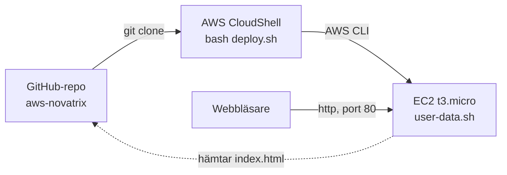
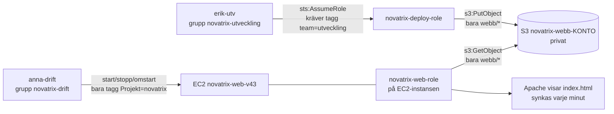
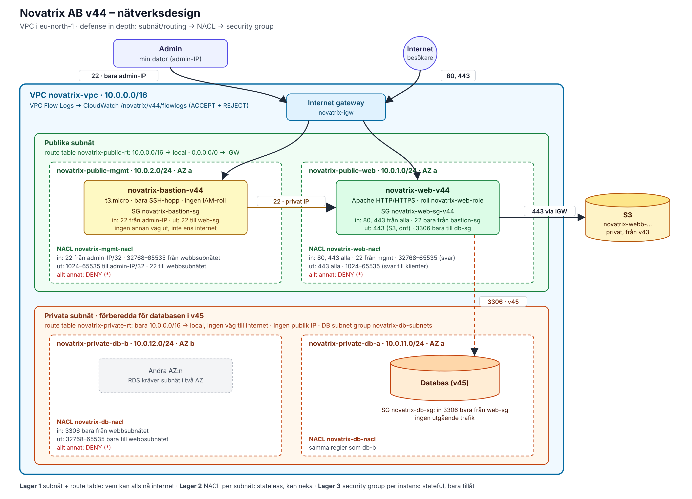

# AWS-miljö från kod – Novatrix webbplats i AWS

Kursprojekt där företaget **Novatrix AB** flyttar sin webbplats till AWS. En mapp per vecka, och varje vecka bygger vidare på samma miljö. Allt skapas och rivs med skript från repot, utan klick i konsolen.

> Projekt inom utbildningen Moln- och virtualiseringsspecialist, Campus Mölndal.

**Teknik:** AWS EC2 · AWS IAM · STS · S3 · VPC · subnät och route tables · internet gateway · NACL · Security groups · bastion host · VPC Flow Logs · CloudWatch Logs · CloudFormation · AWS CLI · CloudShell · SSM Parameter Store · user data (cloud-init) · Amazon Linux 2023 · Apache · AWS Budgets · Bash

| Vecka | Tema | Mapp |
|---|---|---|
| v42 | Compute – EC2-webbserver som skapas helt från kod | [v42](./v42) |
| v43 | IAM – användare, grupper, policies och roller enligt least privilege | [v43](./v43) |
| v44 | Nätverk och säkerhet – eget VPC, publika/privata subnät, NACL:er, security groups och bastion (defense in depth) | [v44](./v44) |

---

## v42 – EC2-webbserver från kod

En EC2-instans (Amazon Linux 2023, `t3.micro`) i region Stockholm kör Apache och visar Novatrix webbsida på instansens publika IP. Hela miljön skapas med ett kommando i AWS CloudShell och tas bort med ett annat. Inget klickas fram i konsolen.



### Vad som skapas

| Resurs | Namn | Inställning |
|---|---|---|
| Key pair | `novatrix-key` | ED25519 |
| Security group | `novatrix-web-sg` | Port 80 från alla, port 22 bara från angiven IP |
| EC2-instans | `novatrix-web-v42` | `t3.micro`, senaste Amazon Linux 2023, publik IPv4 |
| Webbserver | Apache (`httpd`) | Installeras och startas av user data |
| Webbsida | `v42/webb/index.html` | Hämtas från det här repot vid uppstart |

### Förutsättningar

- Ett AWS-konto (Free plan räcker).
- Konsolen inställd på **Europe (Stockholm) `eu-north-1`**.
- Repot är publikt, eftersom instansen hämtar webbsidan härifrån.

Inga verktyg behövs lokalt. AWS CloudShell har AWS CLI och git förinstallerat och är redan inloggat.

### Skapa miljön

1. Ta reda på din publika IP (behövs bara om du vill kunna SSH:a). I PowerShell:

   ```powershell
   curl.exe ifconfig.me
   ```

2. Öppna **CloudShell** i AWS-konsolen och kör:

   ```bash
   git clone https://github.com/adrianahlborg404-png/aws-novatrix.git
   cd aws-novatrix/v42/scripts
   bash deploy.sh <DIN-PUBLIKA-IP>
   ```

3. Skriptet skriver ut instansens publika IP. Vänta 1–2 minuter medan user data installerar Apache.

### Verifiera

```bash
curl -I http://<PUBLIK-IP>        # förväntat: HTTP/1.1 200 OK, Server: Apache
```

Öppna `http://<PUBLIK-IP>` i webbläsaren. Använd **http**, port 443 är inte öppen.

Valfritt, logga in via SSH. Nyckeln `novatrix-key.pem` ligger i `v42/scripts/` i CloudShell:

```bash
ssh -i novatrix-key.pem ec2-user@<PUBLIK-IP>
systemctl status httpd --no-pager                # active (running)
sudo tail -n 20 /var/log/cloud-init-output.log   # loggen från user data
```

SSH från CloudShell kräver att port 22 tillfälligt öppnas för CloudShells IP:

```bash
CS_IP=$(curl -s https://checkip.amazonaws.com)
SG_ID=$(aws ec2 describe-security-groups --group-names novatrix-web-sg \
  --query 'SecurityGroups[0].GroupId' --output text)
aws ec2 authorize-security-group-ingress --group-id $SG_ID --protocol tcp --port 22 --cidr ${CS_IP}/32
# ... efter SSH:
aws ec2 revoke-security-group-ingress --group-id $SG_ID --protocol tcp --port 22 --cidr ${CS_IP}/32
```

### Ta bort miljön

```bash
bash teardown.sh
```

Terminerar instansen och tar bort security group och key pair. Kör alltid `teardown.sh` innan `deploy.sh` körs igen, annars skapas en andra instans.

### Så fungerar skripten

| Fil | Körs var | Gör |
|---|---|---|
| [`v42/scripts/deploy.sh`](v42/scripts/deploy.sh) | CloudShell | Hämtar AMI, skapar key pair och security group, startar instansen med user data |
| [`v42/scripts/user-data.sh`](v42/scripts/user-data.sh) | Instansen, vid första start | Installerar Apache, hämtar `index.html`, startar tjänsten |
| [`v42/scripts/teardown.sh`](v42/scripts/teardown.sh) | CloudShell | Tar bort allt som `deploy.sh` skapade |
| [`v42/webb/index.html`](v42/webb/index.html) | Serveras av Apache | Novatrix webbsida |

Designval:

- **Ingen hårdkodad AMI.** Senaste Amazon Linux 2023 hämtas från SSM-parametern `/aws/service/ami-amazon-linux-latest/al2023-ami-kernel-default-x86_64`.
- **Tål att köras igen.** Key pair och security group återanvänds om de redan finns.
- **Taggar.** `Name=novatrix-web-v42` gör att `teardown.sh` hittar rätt instans.
- **SSH är begränsat.** Port 22 öppnas bara för den IP som anges, aldrig för `0.0.0.0/0`.
- **Repot är källan.** För att ändra webbsidan: committa `index.html`, kör `teardown.sh` och sedan `deploy.sh`.

### Kostnad och säkerhet

- `t3.micro` är free tier-berättigad för nya konton.
- En budget i AWS Budgets (5 USD per månad) larmar via e-post på faktisk och prognostiserad kostnad.
- Miljön rivs med `teardown.sh` efter varje arbetspass.
- `.gitignore` stoppar privata nycklar (`*.pem`, `*.ppk`) från att hamna i repot.

### Filstruktur

```
aws-novatrix/
├── README.md
├── .gitignore
└── v42/
    ├── webb/index.html
    └── scripts/
        ├── deploy.sh
        ├── user-data.sh
        └── teardown.sh
```

## v43 – IAM och identitet

Webbservern från v42 byggs vidare på. Webbsidan ligger nu i en **privat S3-bucket** i stället för att hämtas från GitHub, och allt som når den gör det via IAM med least privilege: människor via grupper, tjänster via roller. Inga åtkomstnycklar finns på servern eller i repot.



### Kedjan av roller

En ändring av webbsidan går genom tre identiteter, och varje led får bara exakt det steget:

1. **erik-utv** (utvecklare) har inga egna rättigheter i S3 eller EC2. Han får bara anta `novatrix-deploy-role`.
2. **novatrix-deploy-role** får läsa och skriva filer under `webb/` i bucketen. Inte radera, inte skriva någon annanstans, inte röra EC2 eller IAM.
3. **novatrix-web-role** sitter på EC2-instansen och får bara *läsa* `webb/*`. En systemd-timer hämtar `index.html` varje minut, så ändringen syns på webbsidan utan SSH eller omstart.

**anna-drift** (drift) står utanför kedjan. Hon kan se, starta, stoppa och starta om Novatrix-instanser och läsa konsolloggen för felsökning, men inte terminera, skapa instanser eller läsa bucketen.

### Vad som skapas

| Typ | Namn | Kopplas till | Ger |
|---|---|---|---|
| S3-bucket | `novatrix-webb-<konto-id>` | – | Privat, all publik åtkomst blockerad |
| Policy | `novatrix-drift-policy` | grupp `novatrix-drift` | Describe i eu-north-1, start/stopp/omstart/konsollogg på instanser med tagg `Projekt=novatrix` |
| Policy | `novatrix-utveckling-policy` | grupp `novatrix-utveckling` | Endast `sts:AssumeRole` på `novatrix-deploy-role` |
| Policy | `novatrix-deploy-s3-write` | roll `novatrix-deploy-role` | `s3:ListBucket` (prefix `webb/`), `s3:GetObject` och `s3:PutObject` på `webb/*` |
| Policy | `novatrix-web-s3-read` | roll `novatrix-web-role` | Endast `s3:GetObject` på `webb/*` |
| Grupp | `novatrix-drift` | användare `anna-drift` (tagg `team=drift`) | – |
| Grupp | `novatrix-utveckling` | användare `erik-utv` (tagg `team=utveckling`) | – |
| Roll | `novatrix-deploy-role` | trust: kontot, villkor `aws:PrincipalTag/team = utveckling` | Max 1 h session |
| Roll + instance profile | `novatrix-web-role` | trust: `ec2.amazonaws.com` | Används av instansen `novatrix-web-v43` |

Alla policies ligger som JSON i [`v43/policies/`](v43/policies). `__KONTO__` och `__BUCKET__` fylls i av skriptet, så inga konto-ID:n finns i repot.

### Varför just så (least privilege)

| Val | Motivering |
|---|---|
| Rättigheter på **grupper**, inte användare | En ny utvecklare läggs i gruppen och får rätt behörighet direkt. Inga policies på enskilda personer att hålla reda på. |
| Användarna har **varken lösenord eller nycklar** | De representerar rollerna i Novatrix. Ingen inloggning som inte behövs kan läcka. I verifieringen får de tillfälliga nycklar som tas bort direkt efteråt. |
| Utvecklare når S3 **bara via en roll** | Rollen ger tillfälliga credentials (max 1 h) och varje session loggas med namn (`erik-deploy`). Inga permanenta nycklar med skrivrätt. |
| **Två spärrar** på deploy-rollen | Identitetspolicyn i gruppen *och* trust-policyns villkor `team=utveckling` måste båda stämma. Även om någon i drift av misstag fick `sts:AssumeRole` skulle trust-policyn neka. |
| Deploy-rollen får **inte radera** | Uppdatera webbsidan räcker. En felaktig `rm` kan inte ta bort sajten. |
| Allt S3 begränsat till **prefixet `webb/`** | Bucketen kan senare användas för t.ex. loggar eller backup utan att webb-rollerna når dem. |
| EC2-rollen får **bara läsa** | En hackad webbserver kan inte ändra webbsidan eller nå andra tjänster. |
| Drift begränsas med **tagg och region** | `aws:ResourceTag/Projekt=novatrix` gör att drift inte kan stoppa andra system i kontot. `aws:RequestedRegion=eu-north-1` håller allt i Stockholm. Terminera ingår inte, det gör `teardown.sh` med admin. |
| `Describe*` på `*` | EC2:s Describe-anrop går inte att begränsa per resurs, därför begränsas de med region i stället. |
| Kundhanterade policies, inte AWS-hanterade | AWS-hanterade som `AmazonS3ReadOnlyAccess` ger läsrätt till *alla* buckets. Egna policies ger exakt rätt resurs. |
| IMDSv2 krävs (`HttpTokens=required`) | Rollens credentials på instansen kan inte hämtas via enkla SSRF-attacker mot metadata-tjänsten. |

### Skapa miljön

Kör `bash ../../v42/scripts/teardown.sh` först om v42-miljön fortfarande finns. Sedan i **CloudShell**:

```bash
git clone https://github.com/adrianahlborg404-png/aws-novatrix.git
cd aws-novatrix/v43/scripts
bash iam-setup.sh               # S3-bucket, policies, grupper, användare, roller
bash deploy.sh <DIN-PUBLIKA-IP> # EC2-instans med rollen novatrix-web-role
```

Vänta 2 minuter medan user data installerar Apache och hämtar webbsidan från S3.

### Verifiera

```bash
bash verify.sh
```

Skriptet gör riktiga AWS-anrop *som* varje identitet och jämför med förväntat resultat:

1. **EC2-rollen** – resultatet från user data visas på `http://<PUBLIK-IP>/iam-test.txt`: läsa från S3 tillåtet, skriva, lista buckets, EC2 och IAM nekat.
2. **anna-drift** – får lista instanser i Stockholm och stoppa Novatrix-instansen (`--dry-run`), men inte i us-east-1, inte terminera, inte läsa S3, inte anta deploy-rollen.
3. **erik-utv** – nekas S3 och EC2 direkt, men får anta `novatrix-deploy-role`. Som rollen får han ladda upp en ny `index.html`, men inte skriva utanför `webb/`, inte radera, inte nå EC2 eller IAM.
4. **Hela kedjan** – texten erik laddade upp syns på webbsidan inom en minut, hämtad av EC2-rollen.

Förväntat slut: `Sammanfattning: 16 OK, 0 FEL`.

`--dry-run` på EC2 betyder att AWS kontrollerar behörigheten utan att utföra anropet: svaret `DryRunOperation` betyder tillåtet, `UnauthorizedOperation` nekat. Instansen stoppas alltså aldrig på riktigt.

### Visa vad som är uppsatt

```bash
bash visa-iam.sh | tee iam-oversikt.txt
```

Skriptet ändrar ingenting. Det hämtar från AWS och skriver ut varje grupp med medlemmar och fullständiga policies, användarna (grupp, tagg, att de saknar lösenord och nycklar), varje roll med trust policy (*vem* får anta den) och behörigheter (*vad* den får göra), EC2-instansens roll och IMDSv2-inställning samt bucketens blockering av publik åtkomst. Konto-ID maskeras. `tee` sparar samtidigt utskriften till `iam-oversikt.txt`, som kan laddas ner från CloudShell via **Actions → Download file**.

Behörigheterna kan också granskas i konsolen under **IAM → Roles → novatrix-deploy-role → Permissions**, och med Policy Simulator.

### Problem jag stötte på: nya nycklar fungerade inte direkt

Första gången jag körde `verify.sh` blev resultatet **15 OK, 1 FEL**:

```
==> 2/4 anna-drift (grupp novatrix-drift)
  Lista EC2-instanser i Stockholm      forvantat TILLATET  fick NEKAT     [FEL]
  Lista EC2-instanser i us-east-1      forvantat NEKAT     fick NEKAT     [OK]
  Stoppa Novatrix-instansen (dry-run)  forvantat TILLATET  fick TILLATET  [OK]
```

**Felsökning.** Policyn kunde inte vara fel. anna fick stoppa instansen i testet direkt efter, och det kräver samma grupp och samma policy. Felet låg alltså i *när* anropet gjordes, inte i *vad* som var tillåtet.

**Orsak.** `verify.sh` skapar en ny access key åt anna och väntade bara tills STS (`sts get-caller-identity`) godkände den. IAM är *eventually consistent*: en ny nyckel sprids till AWS-tjänsterna under några sekunder, och EC2 hade ännu inte fått den. Det första EC2-anropet svarade därför `AuthFailure`. Skriptet tolkade det som nekat, men det var egentligen "okänd nyckel". Några sekunder senare fungerade samma nyckel.

**Lösning.** `verify.sh` väntar nu tills EC2 svarar med något annat än `AuthFailure` innan testerna börjar:

```bash
for i in $(seq 1 20); do
  ut=$(som ec2 describe-instances --dry-run 2>&1)
  [[ "$ut" == *AuthFailure* || "$ut" == *"validate the provided access credentials"* ]] || return 0
  sleep 3
done
```

Efter ändringen gav samma miljö **16 OK, 0 FEL**. Ingen policy behövde ändras.

**Lärdom.** Ett nekat anrop kan ha två helt olika orsaker: `UnauthorizedOperation`/`AccessDenied` betyder att policyn nekar, `AuthFailure` att AWS inte känner igen identiteten. Skript som skapar IAM-resurser och direkt använder dem måste vänta in spridningen. Samma sak gäller `deploy.sh`, som försöker starta instansen igen om instance profile inte syns för EC2 än.

### Ta bort miljön

```bash
bash teardown.sh
```

Tar bort instansen, security group, key pair, roller, instance profile, användare (inklusive eventuella nycklar), grupper, policies och bucketen med innehåll.

### Så fungerar skripten

| Fil | Körs var | Gör |
|---|---|---|
| [`v43/scripts/iam-setup.sh`](v43/scripts/iam-setup.sh) | CloudShell | Skapar bucket, laddar upp `index.html` från v42, skapar policies, grupper, användare och roller. Tål att köras igen |
| [`v43/scripts/deploy.sh`](v43/scripts/deploy.sh) | CloudShell | Som v42, men startar instansen med instance profile `novatrix-web-role` och IMDSv2 |
| [`v43/scripts/user-data.sh`](v43/scripts/user-data.sh) | Instansen, vid första start | Installerar Apache, hämtar webbsidan från S3, startar synk-timern, testar rollens behörigheter |
| [`v43/scripts/verify.sh`](v43/scripts/verify.sh) | CloudShell | Testar alla identiteter och hela kedjan, skriver OK/FEL per test |
| [`v43/scripts/visa-iam.sh`](v43/scripts/visa-iam.sh) | CloudShell | Skriver ut alla grupper, användare, roller och policies som de ligger i AWS |
| [`v43/scripts/teardown.sh`](v43/scripts/teardown.sh) | CloudShell | Tar bort allt i omvänd ordning |
| [`v43/policies/*.json`](v43/policies) | – | Behörighets- och trust-policies som mallar |

### Filstruktur

```
v43/
├── policies/
│   ├── drift.json            # grupp novatrix-drift
│   ├── utveckling.json       # grupp novatrix-utveckling
│   ├── deploy-s3-write.json  # roll novatrix-deploy-role
│   ├── trust-deploy.json     # vem får anta deploy-rollen
│   ├── web-s3-read.json      # roll novatrix-web-role
│   └── trust-ec2.json        # EC2 får anta webb-rollen
└── scripts/
    ├── iam-setup.sh
    ├── deploy.sh
    ├── user-data.sh
    ├── verify.sh
    ├── visa-iam.sh
    └── teardown.sh
```

## v44 – Nätverk och säkerhet (VPC, defense in depth)

Webbservern flyttar från default-VPC:n till ett eget **VPC** som är byggt för Novatrix. Nätverket är definierat som kod i en CloudFormation-mall och delas upp i publika och privata subnät. Trafiken filtreras i tre lager, och bara det som behövs släpps igenom: webben på HTTP/HTTPS, SSH bara via en bastion från en enda IP, och allt annat stängt. De privata subnäten är förberedda för databasen som kommer i v45.

IAM och S3 från v43 återanvänds: webbservern har kvar rollen `novatrix-web-role` och hämtar webbsidan från den privata bucketen.



Skissen finns även som [SVG](v44/docs/natverk.svg).

### Adressplan

| Subnät | CIDR | AZ | Typ | Innehåll |
|---|---|---|---|---|
| `novatrix-public-web` | `10.0.1.0/24` | a | Publikt | Webbservern `novatrix-web-v44` |
| `novatrix-public-mgmt` | `10.0.2.0/24` | a | Publikt | Bastion `novatrix-bastion-v44` |
| `novatrix-private-db-a` | `10.0.11.0/24` | a | Privat | Databasen (v45) |
| `novatrix-private-db-b` | `10.0.12.0/24` | b | Privat | Andra AZ:n, RDS kräver subnät i två AZ |

VPC: `novatrix-vpc`, `10.0.0.0/16`. Webben och administrationen ligger i *olika* subnät, så att varje subnät får en egen NACL med bara sina regler.

### Routing

| Route table | Kopplad till | Routes |
|---|---|---|
| `novatrix-public-rt` | webb, mgmt | `10.0.0.0/16 → local`, `0.0.0.0/0 → novatrix-igw` |
| `novatrix-private-rt` | db-a, db-b | `10.0.0.0/16 → local` (ingen väg ut) |

Det som gör ett subnät publikt är route table-raden mot internet gateway, inte namnet. De privata subnäten har en egen route table i stället för VPC:ns main route table, så att en route som någon lägger till där inte råkar ge databasen en väg ut. De delar inte heller ut publika IP-adresser.

### Lager för lager och vilka hot de skyddar mot

| Lager | Vad | Skyddar mot |
|---|---|---|
| 1. Subnät och routing | Publika och privata subnät, privata saknar route till internet | Att databasen exponeras mot internet, även om någon av misstag ger den en publik IP eller en öppen security group. Utan route finns ingen väg in eller ut. |
| 2. NACL per subnät | Stateless filter på subnätsgränsen, kan *neka* | Felkonfigurerade security groups (t.ex. port 22 öppnad för `0.0.0.0/0`), skanning av portar som inte används, och nya instanser som startas med fel security group i subnätet. |
| 3. Security group per instans | Stateful filter, bara tillåt, kan peka på andra security groups | Lateral rörelse inne i VPC:t: webbservern når bara databasen, bastion når bara webbservern på port 22, databasen når ingenting. Begränsar också vart en hackad webbserver kan ansluta ut: bara 443 och databasen, inte SSH eller andra portar. |
| 4. Bastion | Enda vägen in för SSH, från en IP | Brute force och sårbarheter i SSH på webbservern, som aldrig exponerar port 22 mot internet. Bastion har ingen IAM-roll och ingen väg ut, så den är värdelös för en angripare som tar sig in. Nyckeln stannar i CloudShell (`ProxyCommand -W`), den kopieras aldrig till bastion. |
| 5. IAM (från v43) | Webbserverns roll får bara läsa `webb/*` i S3, IMDSv2 krävs | Att en hackad webbserver kan nå andra AWS-resurser. |
| 6. VPC Flow Logs | Loggar ACCEPT och REJECT för hela VPC:t | Att intrång och skanning går obemärkt förbi. Visar i efterhand vem som försökt nå vad. |

### Security groups

| Security group | In | Ut |
|---|---|---|
| `novatrix-web-sg-v44` | TCP 80, 443 från `0.0.0.0/0` · TCP 22 från `novatrix-bastion-sg` | TCP 443 till `0.0.0.0/0` (S3, dnf) · TCP 3306 till `novatrix-db-sg` |
| `novatrix-bastion-sg` | TCP 22 från admin-IP `/32` | TCP 22 till `novatrix-web-sg-v44` |
| `novatrix-db-sg` | TCP 3306 från `novatrix-web-sg-v44` | Inget |

Standardregeln "all utgående trafik tillåten" är borttagen i alla tre. Reglerna mellan grupperna pekar på *security groups*, inte IP-adresser, så de gäller även om instanserna byts ut och får nya IP:n.

### NACL:er

| NACL | Riktning | Regel | Port | Källa/mål | Varför |
|---|---|---|---|---|---|
| `novatrix-web-nacl` | In | 100 | 80 | `0.0.0.0/0` | HTTP |
| | In | 110 | 443 | `0.0.0.0/0` | HTTPS |
| | In | 120 | 22 | `10.0.2.0/24` (mgmt) | SSH bara från bastionsubnätet |
| | In | 130 | 32768–65535 | `0.0.0.0/0` | Svar på webbserverns egna anrop (S3, dnf, databas) |
| | Ut | 100 | 1024–65535 | `0.0.0.0/0` | Svar till besökare och bastion |
| | Ut | 110 | 443 | `0.0.0.0/0` | S3 och dnf-paket |
| `novatrix-mgmt-nacl` | In | 100 | 22 | admin-IP `/32` | SSH till bastion |
| | In | 110 | 32768–65535 | `10.0.1.0/24` | Svar från webbservern |
| | Ut | 100 | 1024–65535 | admin-IP `/32` | Svar till admin |
| | Ut | 110 | 22 | `10.0.1.0/24` | SSH vidare till webbservern |
| `novatrix-db-nacl` | In | 100 | 3306 | `10.0.1.0/24` | Bara webbsubnätet |
| | Ut | 100 | 32768–65535 | `10.0.1.0/24` | Svar till webbservern |
| Alla | In/Ut | `*` | alla | alla | **DENY**, allt som inte matchar ovan |

**Varför portintervallen?** En NACL är *stateless* och minns inte att en anslutning redan är godkänd, så svarstrafiken måste tillåtas som en egen regel. Svaret går till klientens tillfälliga (ephemeral) port. Besökare på internet kan använda vilken port som helst från 1024 och uppåt (Windows 49152–65535, NAT-routrar hela intervallet), därför `1024–65535` ut. Våra egna servrar kör Amazon Linux som använder `32768–60999`, därför räcker `32768–65535` för svar *till* dem. En security group är *stateful* och släpper automatiskt igenom svaret, så där behövs inga sådana regler.

Det är också därför lagren kompletterar varandra: NACL:en kan inte skilja ett svar från en ny anslutning på en hög port, men security groupen kan. NACL:en kan däremot *neka*, vilket en security group inte kan.

DNS-frågor till VPC:ns resolver (`10.0.0.2`), instansmetadata (`169.254.169.254`) och Amazon Time Sync filtreras inte av NACL:er eller security groups, därför behövs inga regler för dem.

### Placering av lösningen

| Komponent | Subnät | Publik IP | Varför |
|---|---|---|---|
| Webbserver | `novatrix-public-web` | Ja | Ska nås från internet på 80/443. SSH bara från bastion. |
| Bastion | `novatrix-public-mgmt` | Ja | Enda punkten som tar emot SSH utifrån, och då bara från admin-IP. |
| Databas (v45) | `novatrix-private-db-a/b` | Nej | Ska bara nås av webbservern. DB subnet group `novatrix-db-subnets` och `novatrix-db-sg` är redan skapade, så RDS-instansen i v45 behöver bara peka på dem. |

Databasporten är en parameter i mallen (`DbPort`, standard `3306` för MySQL/MariaDB). Blir det PostgreSQL ändras den till `5432` och stacken uppdateras.

### Nätverket som kod

Allt i nätverket finns i en fil, [`v44/cloudformation/natverk.yaml`](v44/cloudformation/natverk.yaml): VPC, internet gateway, fyra subnät, två route tables, tre NACL:er med regler, tre security groups, DB subnet group och flow logs med en egen IAM-roll som bara får skriva till sin loggrupp. `deploy.sh` skapar stacken med `aws cloudformation deploy`, och samma kommando uppdaterar den om mallen eller admin-IP:n ändras.

Varför CloudFormation och inte bara AWS CLI som i v42–v43:

- **Deklarativt.** Mallen beskriver hur nätverket *ska* se ut, inte stegen dit. Körs den igen ändras bara det som skiljer.
- **Beroenden löses automatiskt.** En route mot internet gateway kan inte skapas innan gatewayen är kopplad till VPC:t. CloudFormation räknar ut ordningen.
- **Allt rivs med ett kommando** och i rätt ordning (`delete-stack`).
- **Drift syns.** Ändras något för hand i konsolen visar CloudFormation drift detection skillnaden mot mallen.

Instanserna startas fortfarande med AWS CLI i `deploy.sh`, eftersom de byts ut oftare än nätverket och återanvänder user data-mönstret från v43.

Säkerhetsgrupper som pekar på varandra (bastion → webb → databas) skapar cirkelberoenden i CloudFormation. Det löses genom att några regler är egna resurser (`AWS::EC2::SecurityGroupIngress`) i stället för att ligga inne i gruppen.

### Skapa miljön

I **CloudShell**:

```bash
git clone https://github.com/adrianahlborg404-png/aws-novatrix.git
cd aws-novatrix/v43/scripts
bash iam-setup.sh            # S3-bucket och novatrix-web-role från v43 (tål att köras igen)
cd ../../v44/scripts
bash deploy.sh               # nätverksstacken + webbserver + bastion
```

Utan argument blir CloudShells egen IP admin-IP, så att `verify.sh` kan testa SSH-vägen via bastion. Vill du SSH:a från din egen dator, kör `bash deploy.sh <DIN-PUBLIKA-IP>`. Stacken uppdateras och den gamla IP:n förlorar åtkomst.

Kör `bash teardown.sh` i `v43/scripts` först om v43-instansen fortfarande finns.

### SSH till webbservern via bastion

```bash
ssh -i novatrix-v44-key.pem \
  -o ProxyCommand="ssh -i novatrix-v44-key.pem -W %h:%p ec2-user@<BASTION-IP>" \
  ec2-user@<WEBBSERVERNS-PRIVATA-IP>
```

`deploy.sh` skriver ut kommandot med rätt IP:n. `-W` gör att bastion bara vidarebefordrar TCP-trafiken. Nyckeln och SSH-sessionen till webbservern stannar i CloudShell, och ingen agent forwarding används.

### Verifiera

```bash
bash verify.sh
```

Skriptet gör riktiga anslutningar och jämför med vad som förväntas:

| Del | Test | Förväntat |
|---|---|---|
| 1. Internet → webb | HTTP 80, HTTPS 443 | TILLATET |
| | SSH 22, databasport 3306, port 8080 | BLOCKERAT |
| 2. Internet → bastion | SSH 22 från admin-IP | TILLATET |
| | HTTP 80 | BLOCKERAT |
| 3. Inifrån via bastion | SSH bastion → webbserverns privata IP | TILLATET |
| | bastion → webb port 80, bastion → internet 443 | BLOCKERAT |
| | webb → internet 443 (S3, dnf) | TILLATET |
| | webb → internet 80, webb → internet 22, webb → bastion 22 | BLOCKERAT |
| 4. Ett lager i taget | a) SG öppnad för SSH, NACL stängd | BLOCKERAT (NACL stoppar) |
| | b) båda öppnade (kontroll att testet fungerar) | TILLATET |
| | c) NACL öppnad, SG stängd | BLOCKERAT (SG stoppar) |
| 5. Privata subnät | privat route table har väg till internet | NEJ |
| | privata subnät delar ut publik IP | NEJ |
| | `db-sg` släpper bara in `web-sg` | JA |

Del 4 visar defense in depth i praktiken. Skriptet öppnar tillfälligt SSH för CloudShells IP i *ett* lager i taget, som en felkonfiguration, och visar att det andra lagret fortfarande stoppar trafiken. Reglerna tas bort direkt efteråt, även om skriptet avbryts.

**Blockerat syns som timeout.** NACL:er och security groups svarar inte, de släpper paketet tyst. Därför tolkar skriptet timeout som BLOCKERAT. Om anslutningen i stället nekas direkt (TCP RST) har trafiken nått servern men ingen tjänst lyssnar, det rapporteras som STANGD.

### Se trafiken i flow logs

```bash
bash visa-trafik.sh          # senaste 30 minuterna
bash visa-trafik.sh 60 | tee trafik.txt
```

Skriptet läser VPC Flow Logs från CloudWatch och sammanfattar per server vad som släppts igenom (`ACCEPT`) och blockerats (`REJECT`), både inkommande och utgående, med antal flöden och unika källor. Varje flödespost tolkas från det nätverkskort den loggades på. Loggarna levereras med några minuters fördröjning.

Här syns även trafik som inte kommer från testerna: en publik IP får skanningar från internet inom några minuter, mot portar som SSH (22), RDP (3389) och telnet (23). De ska alla ligga som `REJECT`.

### Ta bort miljön

```bash
bash teardown.sh               # allt: instanser, key pair, nätverksstacken, IAM och S3 från v43
bash teardown.sh --behall-iam  # behåll IAM och S3 till nästa pass
```

### Kostnad

- Två `t3.micro` (webb och bastion) när miljön är uppe. Free tier täcker 750 timmar per månad, och miljön rivs efter varje pass.
- Publika IPv4-adresser kostar 0,005 USD per timme och adress, och bastion är den enda extra.
- Ingen NAT gateway. De privata subnäten behöver ingen väg ut, och en NAT gateway kostar omkring 1 USD per dygn även när den inte används.
- Flow logs: små mängder data till CloudWatch, loggruppen sparas i 3 dagar.

### Så fungerar skripten

| Fil | Körs var | Gör |
|---|---|---|
| [`v44/cloudformation/natverk.yaml`](v44/cloudformation/natverk.yaml) | CloudFormation | Hela nätverket som kod |
| [`v44/scripts/deploy.sh`](v44/scripts/deploy.sh) | CloudShell | Kontrollerar v43:s IAM, skapar/uppdaterar stacken, startar webbserver och bastion. Tål att köras igen |
| [`v44/scripts/user-data.sh`](v44/scripts/user-data.sh) | Webbservern, vid första start | Apache med HTTPS (självsignerat cert), webbsidan från S3, synk-timer, `natverk.txt` med subnät och IP |
| [`v44/scripts/verify.sh`](v44/scripts/verify.sh) | CloudShell | Testar tillåten och blockerad trafik i alla lager |
| [`v44/scripts/visa-trafik.sh`](v44/scripts/visa-trafik.sh) | CloudShell | Sammanfattar VPC Flow Logs (ACCEPT/REJECT) |
| [`v44/scripts/teardown.sh`](v44/scripts/teardown.sh) | CloudShell | Tar bort allt i rätt ordning |
| [`v44/docs/natverk.svg`](v44/docs/natverk.svg) | – | Nätverksskissen (även som PNG) |

HTTPS använder ett självsignerat certifikat, så webbläsaren varnar. Ett riktigt certifikat kräver ett domännamn, till exempel med ACM och en load balancer längre fram.

### Filstruktur

```
v44/
├── cloudformation/
│   └── natverk.yaml      # VPC, subnät, routing, NACL, SG, flow logs
├── docs/
│   ├── natverk.svg       # nätverksskiss
│   └── natverk.png
└── scripts/
    ├── deploy.sh
    ├── user-data.sh
    ├── verify.sh
    ├── visa-trafik.sh
    └── teardown.sh
```

---

## Vad jag lärde mig

**Att user data bara körs en gång.** Skriptet körs som root vid instansens första start, och resultatet syns i `/var/log/cloud-init-output.log`. Vill jag ändra webbsidan räcker det inte att starta om instansen, utan miljön måste rivas och byggas igen. Därför är repot källan och `deploy.sh` och `teardown.sh` hör ihop.

**Att inte hårdkoda det som ändras.** AMI-ID:t för Amazon Linux byts ut när nya versioner släpps. Genom att hämta det från en SSM-parameter fungerar skriptet även nästa termin.

**Att security groups är en del av designen, inte en eftertanke.** Port 80 är öppen för alla, men port 22 bara för min egen IP. CloudShell har en annan IP än min dator, så SSH därifrån kräver en tillfällig regel som tas bort efteråt.

**Att skript ska tåla att köras igen.** Key pair och security group återanvänds om de redan finns, så att ett avbrutet försök inte lämnar halvfärdiga resurser efter sig.

**Att kostnad är något man planerar.** Budgeten larmar innan något kostar, och `teardown.sh` efter varje arbetspass gör att miljön bara finns när den används.

**v43: Att en roll är en identitet utan fasta nycklar.** EC2-instansen, och erik via `sts:AssumeRole`, får tillfälliga credentials som löper ut. Det är skillnaden mot en IAM-användare med access key som ligger kvar tills någon tar bort den.

**v43: Att det krävs två policies för att anta en roll.** Den som ska anta rollen behöver `sts:AssumeRole` i sin egen policy, och rollens trust-policy måste släppa in den. Med ett taggvillkor i trust-policyn blir det två oberoende spärrar.

**v43: Att least privilege handlar om resurser och villkor, inte bara actions.** `s3:GetObject` på `*` och på `bucket/webb/*` är samma action men helt olika risk. Taggar och region som villkor gör att samma policy fungerar när fler system tillkommer.

**v43: Att verifiera nekat är lika viktigt som tillåtet.** Ett test som bara visar att något fungerar säger inget om least privilege. Därför testar `verify.sh` varje roll både mot det den ska få och det den inte ska få.

**v43: Att IAM är eventually consistent.** En ny access key godkändes av STS direkt men avvisades av EC2 några sekunder till. Ett nekat anrop behöver därför inte betyda fel policy. Felkoden skiljer `AuthFailure` (okänd identitet) från `UnauthorizedOperation` (nekad av policy).

**v44: Att publikt och privat bestäms av routing.** Ett subnät blir publikt av en route mot internet gateway, inte av namnet. Utan den routen kan en databas inte nås utifrån ens om den skulle få en öppen security group.

**v44: Skillnaden mellan stateless och stateful.** En NACL minns inga anslutningar, så svarstrafiken måste tillåtas på ephemeral-portar. En security group släpper igenom svaret automatiskt. Därför kompletterar de varandra: NACL:en kan neka, security groupen kan skilja svar från nya anslutningar.

**v44: Att security groups kan peka på varandra.** `db-sg` släpper in från `web-sg`, inte från en IP. Regeln följer med när instanser byts ut, och kedjan admin → bastion → webb → databas blir tydlig i koden.

**v44: Att begränsa utgående trafik också.** Standardregeln i en security group tillåter all trafik ut. Tas den bort kan en hackad server inte ringa hem på godtyckliga portar, och bastion når inget annat än webbserverns port 22.

**v44: Att testa ett lager i taget.** Det räcker inte att visa att SSH är blockerat, eftersom det inte visar *vilket* lager som stoppar. Genom att öppna ett lager i taget syns att vart och ett håller på egen hand, och kontrolltestet med båda öppna visar att testet i sig fungerar.

**v44: Att infrastruktur som kod gör nätverket granskningsbart.** Alla regler finns i en fil som kan läsas, versionshanteras och rivas med ett kommando, i stället för klick i konsolen som ingen kan se i efterhand.
