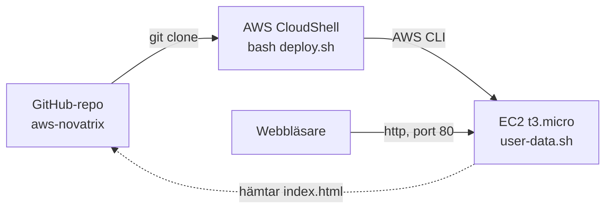
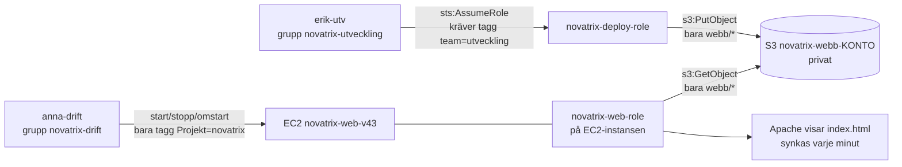
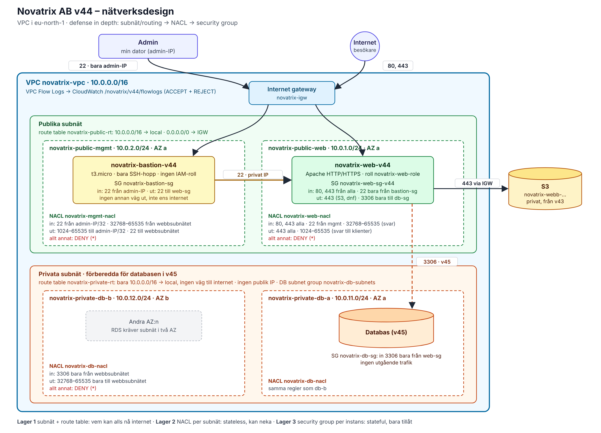
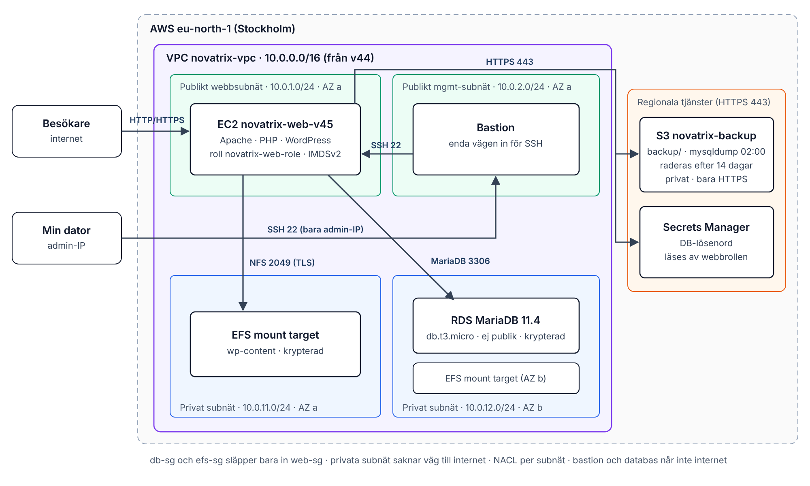
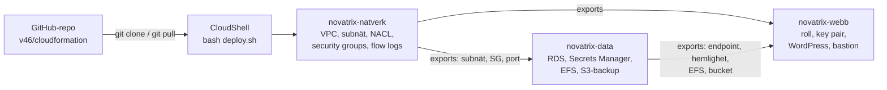

# AWS-miljö från kod – Novatrix webbplats i AWS

[](https://github.com/adrianahlborg404-png/aws-novatrix/actions/workflows/ci.yml)

Kursprojekt där företaget **Novatrix AB** flyttar sin webbplats till AWS. En mapp per vecka, och varje vecka bygger vidare på samma miljö. Allt skapas och rivs med skript från repot, utan klick i konsolen.

> Projekt inom utbildningen Moln- och virtualiseringsspecialist, Campus Mölndal.

**Teknik:** AWS EC2 · AWS IAM · STS · S3 (livscykelregler) · VPC · subnät och route tables · internet gateway · NACL · Security groups · bastion host · VPC Flow Logs · CloudWatch Logs · RDS (MariaDB) · EFS · Secrets Manager · CloudFormation (exports/imports, change sets, drift detection) · AWS CLI · CloudShell · SSM Parameter Store · user data (cloud-init) · Amazon Linux 2023 · Apache · PHP · WordPress · AWS Budgets · Bash · Git · GitHub Actions · ShellCheck · cfn-lint

| Vecka | Tema | Mapp |
|---|---|---|
| v42 | Compute – EC2-webbserver som skapas helt från kod | [v42](./v42) |
| v43 | IAM – användare, grupper, policies och roller enligt least privilege | [v43](./v43) |
| v44 | Nätverk och säkerhet – eget VPC, publika/privata subnät, NACL:er, security groups och bastion (defense in depth) | [v44](./v44) |
| v45 | Lagring och databas – WordPress mot RDS och EFS, backup till S3 med livscykelregel | [v45](./v45) |
| v46 | IaC med CloudFormation – hela stacken som kod i tre lager, parametriserad, med CI i GitHub Actions | [v46](./v46) |

Allt körs i **AWS CloudShell** i region **Stockholm (`eu-north-1`)**. Miljön rivs med `teardown.sh` efter varje arbetspass, och en budget i AWS Budgets (5 USD/mån) larmar innan något kostar.

---

## v42 – EC2-webbserver från kod

En EC2-instans med Apache visar Novatrix webbsida. Hela miljön skapas med ett kommando och rivs med ett annat.



**Byggt**
- EC2 `t3.micro` med senaste Amazon Linux 2023. AMI-ID:t hämtas från SSM Parameter Store, inte hårdkodat.
- User data installerar Apache och hämtar `index.html` från repot.
- Security group `novatrix-web-sg`: port 80 från alla, port 22 bara från min IP.
- Key pair `novatrix-key` (ED25519). `.gitignore` stoppar `*.pem` från repot.

**Kör**
```bash
cd aws-novatrix/v42/scripts
bash deploy.sh <DIN-PUBLIKA-IP>   # skapar allt, skriver ut publik IP
curl -I http://<PUBLIK-IP>        # HTTP/1.1 200 OK, Server: Apache
bash teardown.sh                  # tar bort allt
```

**Filer:** [`deploy.sh`](v42/scripts/deploy.sh) · [`user-data.sh`](v42/scripts/user-data.sh) · [`teardown.sh`](v42/scripts/teardown.sh) · [`index.html`](v42/webb/index.html)

---

## v43 – IAM och identitet

Webbsidan flyttas till en **privat S3-bucket** och allt som når den gör det via IAM med least privilege: människor via grupper, tjänster via roller. Inga åtkomstnycklar finns på servern eller i repot.



**Byggt**

| Identitet | Får göra |
|---|---|
| `anna-drift` (grupp `novatrix-drift`) | Se, starta, stoppa och starta om instanser med tagg `Projekt=novatrix` i Stockholm. Inte terminera, inte S3. |
| `erik-utv` (grupp `novatrix-utveckling`) | Bara anta `novatrix-deploy-role` |
| `novatrix-deploy-role` | Läsa och skriva `webb/*` i bucketen. Kräver tagg `team=utveckling`, max 1 h session. |
| `novatrix-web-role` (på EC2) | Bara läsa `webb/*`. IMDSv2 krävs. |

- Användarna har varken lösenord eller nycklar. Behörigheter sitter på grupper, aldrig på personer.
- Egna policies som JSON-mallar i [`v43/policies/`](v43/policies) i stället för AWS-hanterade (som ger åtkomst till *alla* buckets).
- En systemd-timer på servern hämtar `index.html` från S3 varje minut.

**Kör**
```bash
cd aws-novatrix/v43/scripts
bash iam-setup.sh                 # bucket, policies, grupper, användare, roller
bash deploy.sh <DIN-PUBLIKA-IP>   # EC2 med novatrix-web-role
bash verify.sh                    # testar varje identitet, tillåtet och nekat
bash visa-iam.sh                  # skriver ut allt som är uppsatt
bash teardown.sh
```

**Resultat:** `verify.sh` gav **16 OK, 0 FEL**. Kedjan erik-utv → deploy-roll → S3 → EC2-roll → webbsida fungerar, och varje identitet nekas allt utanför sin roll.

**Problem:** första körningen gav 15 OK, 1 FEL. En ny access key godkändes av STS men inte direkt av EC2, eftersom IAM är *eventually consistent*. `verify.sh` väntar nu tills EC2 känner igen nyckeln (`AuthFailure` betyder okänd identitet, `UnauthorizedOperation` betyder nekad av policy).

**Filer:** [`iam-setup.sh`](v43/scripts/iam-setup.sh) · [`deploy.sh`](v43/scripts/deploy.sh) · [`user-data.sh`](v43/scripts/user-data.sh) · [`verify.sh`](v43/scripts/verify.sh) · [`visa-iam.sh`](v43/scripts/visa-iam.sh) · [`teardown.sh`](v43/scripts/teardown.sh) · [`policies/`](v43/policies)

---

## v44 – Nätverk och säkerhet (VPC, defense in depth)

Webbservern flyttar till ett **eget VPC** med publika och privata subnät. Trafiken filtreras i flera lager och bara det nödvändiga släpps igenom: webben på HTTP/HTTPS, SSH bara via en bastion från min IP, allt annat stängt. Nätverket är definierat som kod i CloudFormation. IAM och S3 från v43 återanvänds.



**Byggt**

| Subnät | CIDR | Typ | Innehåll |
|---|---|---|---|
| `novatrix-public-web` | `10.0.1.0/24` | Publikt | Webbserver (Apache HTTP/HTTPS) |
| `novatrix-public-mgmt` | `10.0.2.0/24` | Publikt | Bastion, enda vägen in för SSH |
| `novatrix-private-db-a/b` | `10.0.11.0/24`, `10.0.12.0/24` | Privat | Förberett för databasen i v45 (två AZ) |

| Lager | Skydd |
|---|---|
| Routing | Bara publika subnät har route till internet gateway. De privata har ingen väg ut. |
| NACL per subnät | Stateless. Bara nödvändiga portar plus svarstrafik, allt annat DENY. |
| Security groups | Kedjan admin-IP → bastion → webb → databas. Ingen fri utgående trafik. |
| Bastion | Ingen IAM-roll, ingen väg ut. Webbservern exponerar aldrig port 22. |
| VPC Flow Logs | ACCEPT och REJECT loggas till CloudWatch. |

**Kör**
```bash
cd aws-novatrix/v43/scripts && bash iam-setup.sh
cd ../../v44/scripts
bash deploy.sh <DIN-PUBLIKA-IP>   # CloudFormation-stacken + webbserver + bastion
bash verify.sh                    # tillåten och blockerad trafik, ett lager i taget
bash visa-trafik.sh 60            # sammanfattning av flow logs
bash teardown.sh                  # allt, även IAM och S3 från v43
```

SSH från datorn sker via bastion med `ProxyJump`. `deploy.sh` skriver ut ett färdigt block till `~/.ssh/config`, och sedan räcker `ssh novatrix-web`.

**Resultat:** `verify.sh` gav **21 OK, 0 FEL**. Testet där ett lager öppnas i taget visar att NACL stoppar när security groupen är öppen, och tvärtom. Flow logs visade automatiska skanningar från internet mot SSH, RDP, MS SQL, MongoDB och Redis, som alla blockerades.

**Filer:** [`natverk.yaml`](v44/cloudformation/natverk.yaml) · [`deploy.sh`](v44/scripts/deploy.sh) · [`user-data.sh`](v44/scripts/user-data.sh) · [`verify.sh`](v44/scripts/verify.sh) · [`visa-trafik.sh`](v44/scripts/visa-trafik.sh) · [`teardown.sh`](v44/scripts/teardown.sh) · [`natverk.svg`](v44/docs/natverk.svg)

---

## v45 – Lagring och databas (WordPress)

WordPress-stacken tar form: en hanterad databas, delad lagring för WordPress-filerna och objektlagring för backup. Databasen ligger i de privata subnäten från v44 och nås bara från webbservern. Datalagret är kod i CloudFormation ([`data.yaml`](v45/cloudformation/data.yaml)) och läggs som en egen stack ovanpå nätverksstacken från v44. Rollen från v43 återanvänds.



**Byggt och valda nivåer**

| Komponent | Val | Varför |
|---|---|---|
| RDS MariaDB 11.4 | `db.t3.micro`, 20 GB `gp3`, en AZ | Minsta klassen räcker för en liten sajt och ryms i Free plan. `gp3` ger 3 000 IOPS i grunden till samma pris som `gp2`. Multi-AZ dubblar kostnaden och väljs i drift när sajten inte får ligga nere. 11.4 i stället för 11.8, som kräver TLS för alla anslutningar. |
| RDS automatisk backup | 1 dag (max på Free plan) | I drift hade jag valt **7 dagar**: ett fel som görs på fredagen och upptäcks på måndagen går fortfarande att återställa, med point-in-time restore till valfri minut. Backuputrymme upp till databasens storlek ingår utan extra kostnad. |
| EFS | Regional, `bursting`, krypterad, IA efter 30 dagar | Filerna överlever att webbservern byts ut, och flera webbservrar kan dela dem. `bursting` har ingen avgift per läst GB. Filer som inte används flyttas till billigare Infrequent Access. One Zone hade varit ungefär hälften så dyrt, men faller om AZ:n faller. |
| S3 `novatrix-backup-<konto>` | Privat, AES256, bara HTTPS, livscykelregel | En `mysqldump` varje natt kl 02:00. Regeln raderar filer under `backup/` efter **14 dagar**, så lagringen växer inte för evigt. |
| Lösenord | Secrets Manager | Genereras när stacken skapas. Finns aldrig i repot, skripten eller loggarna. `wp-config.php` skrivs av user data, så WordPress-installationen frågar inte efter något lösenord. |

**Säker åtkomst i lager**

| Lager | Skydd |
|---|---|
| Routing | De privata subnäten har ingen väg till internet. |
| NACL | De privata subnäten släpper bara in 3306 och 2049, och bara från webbsubnätet. |
| Security groups | `db-sg` och `efs-sg` släpper bara in `web-sg`, och har ingen utgående trafik. Webbservern får bara 443 ut, plus 3306 och 2049 till just de grupperna. |
| Ingen publik adress | `PubliclyAccessible: false`, DNS-namnet pekar på en privat IP. |
| Kryptering | RDS, EFS och S3 i vila. EFS även på vägen (`tls`). S3 nekar allt utan HTTPS. |
| IAM | Rollen får bara läsa *den här* hemligheten och bara skriva nya filer under `backup/`. |

**Kör**
```bash
cd aws-novatrix/v43/scripts && bash iam-setup.sh
cd ../../v45/scripts
bash deploy.sh <DIN-PUBLIKA-IP>   # nätverk (v44) + datastack + WordPress-server + bastion
# öppna http://<webb-ip> och kör WordPress-installationen (språk, namn, admin-konto)
bash verify.sh                    # WordPress, databas, EFS, S3, åtkomst och en backup
bash teardown.sh                  # allt, även nätverket och IAM
```

**Resultat:** `verify.sh` gav **27 OK, 0 FEL**. WordPress är installerat mot RDS (12 tabeller) med uppladdade filer på EFS, databasen och EFS nås bara från webbservern, och en databasdump hamnade i `backup/` i S3.

**Filer:** [`data.yaml`](v45/cloudformation/data.yaml) · [`deploy.sh`](v45/scripts/deploy.sh) · [`user-data.sh`](v45/scripts/user-data.sh) · [`verify.sh`](v45/scripts/verify.sh) · [`teardown.sh`](v45/scripts/teardown.sh) · [`arkitektur.svg`](v45/docs/arkitektur.svg)

---

## v46 – IaC med CloudFormation (hela stacken som kod)

Hela miljön från v42–v45 är nu kod: nätverk, säkerhet, IAM-roll, databas, lagring och servrar. Tre stackar byggs med ett kommando och rivs med ett annat, utan ett enda steg i konsolen och utan något kvar från tidigare veckor. Strukturen följer kursens startpaket (tre lager, `Prefix`, samma exportnamn), fylld med mitt eget nät från v44.



**De tre lagren**

| Stack | Mall | Innehåll |
|---|---|---|
| `novatrix-natverk` | [`natverk.yaml`](v46/cloudformation/natverk.yaml) | VPC, 2 publika och 2 privata subnät (adresserna räknas ut från `VpcCidr` med `!Cidr`), routing, en NACL per subnät, security groups för bastion, webb, databas och EFS, VPC Flow Logs |
| `novatrix-data` | [`data.yaml`](v46/cloudformation/data.yaml) | Subnet group, lösenord i Secrets Manager, RDS MariaDB, EFS med mount targets i båda AZ, S3-bucket för backup med livscykelregel |
| `novatrix-webb` | [`webb.yaml`](v46/cloudformation/webb.yaml) | Webbserverns roll, key pair, launch templates med IMDSv2, WordPress-servern och bastion |

Lagren hänger ihop med **exports och `!ImportValue`**, så det finns inga ID:n att klistra in. Det styr också ordningen: en stack vars exports används går inte att radera, så rivningen sker i omvänd ordning (webb → data → nätverk).

**Från skript till kod**

| Tidigare | I v46 |
|---|---|
| v43: `iam-setup.sh` skapar rollen med CLI | `AWS::IAM::Role` i `webb.yaml` |
| v42–v45: key pair och EC2 med `aws ec2 run-instances` | `AWS::EC2::KeyPair`, launch templates och `AWS::EC2::Instance`. Privata nyckeln sparas av AWS i SSM Parameter Store och hämtas av `deploy.sh` |
| v45: skriptet läser ID:n från v44 och skickar dem som parametrar | `!ImportValue`, inga ID:n i skripten |
| v45: datastacken lägger regler i v44:s security groups och NACL | Alla regler ligger i nätverksmallen, inget ändras utanför sin egen stack |
| Man ser inte om servern faktiskt blev klar | `CreationPolicy` + `cfn-signal`: webbstacken blir klar först när WordPress svarar och når databasen. Annars rullas den tillbaka. |

**Parametriserat och återanvändbart**

Det som skiljer en miljö från en annan står i en parameterfil, inte i mallarna. Allt får namn från `Prefix`, även exports, buckets och roller. Därför kan en andra, helt fristående kopia byggas i samma konto:

```bash
bash deploy.sh -p ../parametrar/novatrix-test.env <DIN-PUBLIKA-IP>   # novatrix-test-*, VPC 10.1.0.0/16
bash teardown.sh -p ../parametrar/novatrix-test.env
```

| Parameterfil | Innehåll |
|---|---|
| [`novatrix.env`](v46/parametrar/novatrix.env) | Kursmiljön: `PREFIX=novatrix`, `VPC_CIDR=10.0.0.0/16`, instanstyp, RDS-klass, lagring och backupdagar |
| [`novatrix-test.env`](v46/parametrar/novatrix-test.env) | Samma kod, `PREFIX=novatrix-test` och `VPC_CIDR=10.1.0.0/16` |

**Varför mitt eget nät i stället för startpaketets**

Startpaketets `natverk.yaml` har ett publikt subnät där webbservern tar emot SSH direkt från min IP, en NACL och fri utgående trafik. Jag har behållit strukturen (stacknamn, `Prefix`, `MyIp` och exportnamnen som de andra lagren importerar), men fyllt den med nätet från v44. Uppgiften är att göra *min* stack till kod, och VG-kravet är säkerhet i flera lager:

- **Bastion i ett eget mgmt-subnät.** Webbservern exponerar aldrig port 22 mot internet.
- **En NACL per subnät** (webb, mgmt, privat) i stället för en.
- **Begränsad utgående trafik.** Webben får bara 443 ut, plus databasen och EFS. Databasen, EFS och bastion når inte internet alls.
- **VPC Flow Logs**, så att jag kan visa vad som släpps igenom och vad som blockeras.

Adresserna skiljer sig därför från skelettet: där är `10.0.2.0/24` ett privat subnät, hos mig är det mgmt-subnätet. De privata subnäten ligger kvar på `10.0.11.0/24` och `10.0.12.0/24` som i v44.

**Versionshantering som arbetsverktyg**

Alla ändringar går via Git. Ingenting ändras för hand i konsolen.

1. Ändra mallen, committa och pusha. **CI** i GitHub Actions kontrollerar skripten (`bash -n`, ShellCheck) och mallarna (cfn-lint) och ger en grön bock eller ett rött kryss.
2. `git pull` i CloudShell.
3. `bash andring.sh <lager>` skapar ett **change set** och visar vad som kommer att läggas till, ändras eller ersättas, *innan* något rörs.
4. `j` kör ändringen, `n` kastar change setet.
5. `verify.sh` kör **drift detection**, som visar om någon har ändrat något i konsolen som inte finns i koden.

**Kör (återskapa hela stacken från repot)**

Från ett tomt konto behövs bara CloudShell och repot. Ingenting från v42–v45 behöver finnas.

```bash
git clone https://github.com/adrianahlborg404-png/aws-novatrix.git
cd aws-novatrix/v46/scripts
bash deploy.sh <DIN-PUBLIKA-IP>   # validera, nätverk -> data -> webb, 15-25 min första gången
# öppna http://<webb-ip> och kör WordPress-installationen (språk, namn, admin-konto)
bash verify.sh                    # stackar, drift, WordPress, data, lagring och åtkomst
bash andring.sh webb              # en ändring visas som change set innan den körs
bash teardown.sh                  # webb -> data -> nätverk
```

`deploy.sh` är samma kommando för att skapa och för att uppdatera: CloudFormation räknar ut skillnaden. Kursens två demomallar från startpaketet ligger i [`v46/demo`](v46/demo).

**Filer:** [`natverk.yaml`](v46/cloudformation/natverk.yaml) · [`data.yaml`](v46/cloudformation/data.yaml) · [`webb.yaml`](v46/cloudformation/webb.yaml) · [`parametrar/`](v46/parametrar) · [`deploy.sh`](v46/scripts/deploy.sh) · [`verify.sh`](v46/scripts/verify.sh) · [`andring.sh`](v46/scripts/andring.sh) · [`teardown.sh`](v46/scripts/teardown.sh) · [`ci.yml`](.github/workflows/ci.yml)

---

## Vad jag lärde mig

| Vecka | Lärdomar |
|---|---|
| v42 | User data körs bara vid första start. Hårdkoda inte det som ändras, som AMI-ID. Skript ska tåla att köras igen. |
| v43 | En roll ger tillfälliga credentials, inte fasta nycklar. Att anta en roll kräver både identitetspolicy och trust policy. Least privilege handlar om resurser och villkor, inte bara actions. Testa nekat lika noga som tillåtet. |
| v44 | Publikt eller privat bestäms av routing. NACL (stateless, kan neka) och security groups (stateful, pekar på varandra) kompletterar varandra. Begränsa utgående trafik också. Internet skannar öppna portar inom minuter. |
