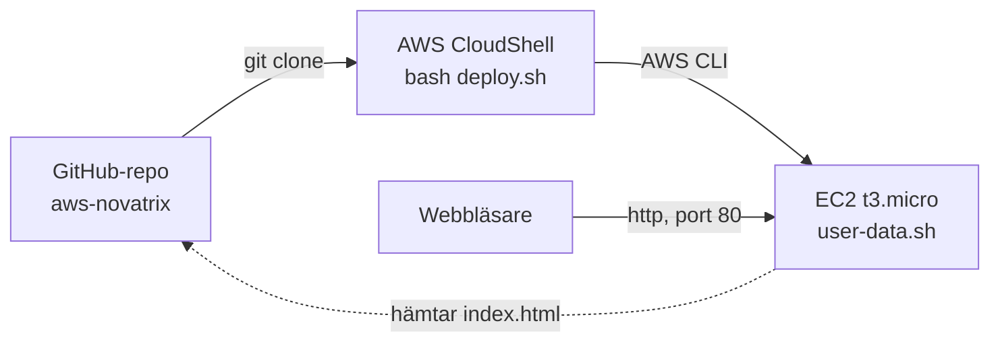
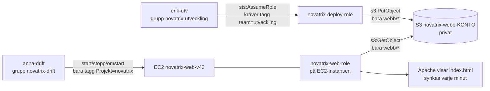

# AWS-miljö från kod – Novatrix webbplats i AWS

Kursprojekt där företaget **Novatrix AB** flyttar sin webbplats till AWS. En mapp per vecka, och varje vecka bygger vidare på samma miljö. Allt skapas och rivs med skript från repot, utan klick i konsolen.

> Projekt inom utbildningen Moln- och virtualiseringsspecialist, Campus Mölndal.

**Teknik:** AWS EC2 · AWS IAM · STS · S3 · AWS CLI · CloudShell · Security groups · SSM Parameter Store · user data (cloud-init) · Amazon Linux 2023 · Apache · AWS Budgets · Bash

| Vecka | Tema | Mapp |
|---|---|---|
| v42 | Compute – EC2-webbserver som skapas helt från kod | [v42](./v42) |
| v43 | IAM – användare, grupper, policies och roller enligt least privilege | [v43](./v43) |

---

## v42 – EC2-webbserver från kod

En EC2-instans (Amazon Linux 2023, `t3.micro`) i region Stockholm kör Apache och visar Novatrix webbsida på instansens publika IP. Hela miljön skapas med ett kommando i AWS CloudShell och tas bort med ett annat. Inget klickas fram i konsolen.



### Vad som skapas

| Resurs | Namn | Inställning |
|---|---|---|
| Key pair | `novatrix-key` | ED25519 |
| Security group | `novatrix-web-sg` | Port 80 från alla, port 22 bara från angiven IP |
| EC2-instans | `novatrix-web-v42` | `t3.micro`, senaste Amazon Linux 2023, publik IPv4 |
| Webbserver | Apache (`httpd`) | Installeras och startas av user data |
| Webbsida | `v42/webb/index.html` | Hämtas från det här repot vid uppstart |

### Förutsättningar

- Ett AWS-konto (Free plan räcker).
- Konsolen inställd på **Europe (Stockholm) `eu-north-1`**.
- Repot är publikt, eftersom instansen hämtar webbsidan härifrån.

Inga verktyg behövs lokalt. AWS CloudShell har AWS CLI och git förinstallerat och är redan inloggat.

### Skapa miljön

1. Ta reda på din publika IP (behövs bara om du vill kunna SSH:a). I PowerShell:

   ```powershell
   curl.exe ifconfig.me
   ```

2. Öppna **CloudShell** i AWS-konsolen och kör:

   ```bash
   git clone https://github.com/adrianahlborg404-png/aws-novatrix.git
   cd aws-novatrix/v42/scripts
   bash deploy.sh <DIN-PUBLIKA-IP>
   ```

3. Skriptet skriver ut instansens publika IP. Vänta 1–2 minuter medan user data installerar Apache.

### Verifiera

```bash
curl -I http://<PUBLIK-IP>        # förväntat: HTTP/1.1 200 OK, Server: Apache
```

Öppna `http://<PUBLIK-IP>` i webbläsaren. Använd **http**, port 443 är inte öppen.

Valfritt, logga in via SSH. Nyckeln `novatrix-key.pem` ligger i `v42/scripts/` i CloudShell:

```bash
ssh -i novatrix-key.pem ec2-user@<PUBLIK-IP>
systemctl status httpd --no-pager                # active (running)
sudo tail -n 20 /var/log/cloud-init-output.log   # loggen från user data
```

SSH från CloudShell kräver att port 22 tillfälligt öppnas för CloudShells IP:

```bash
CS_IP=$(curl -s https://checkip.amazonaws.com)
SG_ID=$(aws ec2 describe-security-groups --group-names novatrix-web-sg \
  --query 'SecurityGroups[0].GroupId' --output text)
aws ec2 authorize-security-group-ingress --group-id $SG_ID --protocol tcp --port 22 --cidr ${CS_IP}/32
# ... efter SSH:
aws ec2 revoke-security-group-ingress --group-id $SG_ID --protocol tcp --port 22 --cidr ${CS_IP}/32
```

### Ta bort miljön

```bash
bash teardown.sh
```

Terminerar instansen och tar bort security group och key pair. Kör alltid `teardown.sh` innan `deploy.sh` körs igen, annars skapas en andra instans.

### Så fungerar skripten

| Fil | Körs var | Gör |
|---|---|---|
| [`v42/scripts/deploy.sh`](v42/scripts/deploy.sh) | CloudShell | Hämtar AMI, skapar key pair och security group, startar instansen med user data |
| [`v42/scripts/user-data.sh`](v42/scripts/user-data.sh) | Instansen, vid första start | Installerar Apache, hämtar `index.html`, startar tjänsten |
| [`v42/scripts/teardown.sh`](v42/scripts/teardown.sh) | CloudShell | Tar bort allt som `deploy.sh` skapade |
| [`v42/webb/index.html`](v42/webb/index.html) | Serveras av Apache | Novatrix webbsida |

Designval:

- **Ingen hårdkodad AMI.** Senaste Amazon Linux 2023 hämtas från SSM-parametern `/aws/service/ami-amazon-linux-latest/al2023-ami-kernel-default-x86_64`.
- **Tål att köras igen.** Key pair och security group återanvänds om de redan finns.
- **Taggar.** `Name=novatrix-web-v42` gör att `teardown.sh` hittar rätt instans.
- **SSH är begränsat.** Port 22 öppnas bara för den IP som anges, aldrig för `0.0.0.0/0`.
- **Repot är källan.** För att ändra webbsidan: committa `index.html`, kör `teardown.sh` och sedan `deploy.sh`.

### Kostnad och säkerhet

- `t3.micro` är free tier-berättigad för nya konton.
- En budget i AWS Budgets (5 USD per månad) larmar via e-post på faktisk och prognostiserad kostnad.
- Miljön rivs med `teardown.sh` efter varje arbetspass.
- `.gitignore` stoppar privata nycklar (`*.pem`, `*.ppk`) från att hamna i repot.

### Filstruktur

```
aws-novatrix/
├── README.md
├── .gitignore
└── v42/
    ├── webb/index.html
    └── scripts/
        ├── deploy.sh
        ├── user-data.sh
        └── teardown.sh
```

## v43 – IAM och identitet

Webbservern från v42 byggs vidare på. Webbsidan ligger nu i en **privat S3-bucket** i stället för att hämtas från GitHub, och allt som når den gör det via IAM med least privilege: människor via grupper, tjänster via roller. Inga åtkomstnycklar finns på servern eller i repot.



### Kedjan av roller

En ändring av webbsidan går genom tre identiteter, och varje led får bara exakt det steget:

1. **erik-utv** (utvecklare) har inga egna rättigheter i S3 eller EC2. Han får bara anta `novatrix-deploy-role`.
2. **novatrix-deploy-role** får läsa och skriva filer under `webb/` i bucketen. Inte radera, inte skriva någon annanstans, inte röra EC2 eller IAM.
3. **novatrix-web-role** sitter på EC2-instansen och får bara *läsa* `webb/*`. En systemd-timer hämtar `index.html` varje minut, så ändringen syns på webbsidan utan SSH eller omstart.

**anna-drift** (drift) står utanför kedjan. Hon kan se, starta, stoppa och starta om Novatrix-instanser och läsa konsolloggen för felsökning, men inte terminera, skapa instanser eller läsa bucketen.

### Vad som skapas

| Typ | Namn | Kopplas till | Ger |
|---|---|---|---|
| S3-bucket | `novatrix-webb-<konto-id>` | – | Privat, all publik åtkomst blockerad |
| Policy | `novatrix-drift-policy` | grupp `novatrix-drift` | Describe i eu-north-1, start/stopp/omstart/konsollogg på instanser med tagg `Projekt=novatrix` |
| Policy | `novatrix-utveckling-policy` | grupp `novatrix-utveckling` | Endast `sts:AssumeRole` på `novatrix-deploy-role` |
| Policy | `novatrix-deploy-s3-write` | roll `novatrix-deploy-role` | `s3:ListBucket` (prefix `webb/`), `s3:GetObject` och `s3:PutObject` på `webb/*` |
| Policy | `novatrix-web-s3-read` | roll `novatrix-web-role` | Endast `s3:GetObject` på `webb/*` |
| Grupp | `novatrix-drift` | användare `anna-drift` (tagg `team=drift`) | – |
| Grupp | `novatrix-utveckling` | användare `erik-utv` (tagg `team=utveckling`) | – |
| Roll | `novatrix-deploy-role` | trust: kontot, villkor `aws:PrincipalTag/team = utveckling` | Max 1 h session |
| Roll + instance profile | `novatrix-web-role` | trust: `ec2.amazonaws.com` | Används av instansen `novatrix-web-v43` |

Alla policies ligger som JSON i [`v43/policies/`](v43/policies). `__KONTO__` och `__BUCKET__` fylls i av skriptet, så inga konto-ID:n finns i repot.

### Varför just så (least privilege)

| Val | Motivering |
|---|---|
| Rättigheter på **grupper**, inte användare | En ny utvecklare läggs i gruppen och får rätt behörighet direkt. Inga policies på enskilda personer att hålla reda på. |
| Användarna har **varken lösenord eller nycklar** | De representerar rollerna i Novatrix. Ingen inloggning som inte behövs kan läcka. I verifieringen får de tillfälliga nycklar som tas bort direkt efteråt. |
| Utvecklare når S3 **bara via en roll** | Rollen ger tillfälliga credentials (max 1 h) och varje session loggas med namn (`erik-deploy`). Inga permanenta nycklar med skrivrätt. |
| **Två spärrar** på deploy-rollen | Identitetspolicyn i gruppen *och* trust-policyns villkor `team=utveckling` måste båda stämma. Även om någon i drift av misstag fick `sts:AssumeRole` skulle trust-policyn neka. |
| Deploy-rollen får **inte radera** | Uppdatera webbsidan räcker. En felaktig `rm` kan inte ta bort sajten. |
| Allt S3 begränsat till **prefixet `webb/`** | Bucketen kan senare användas för t.ex. loggar eller backup utan att webb-rollerna når dem. |
| EC2-rollen får **bara läsa** | En hackad webbserver kan inte ändra webbsidan eller nå andra tjänster. |
| Drift begränsas med **tagg och region** | `aws:ResourceTag/Projekt=novatrix` gör att drift inte kan stoppa andra system i kontot. `aws:RequestedRegion=eu-north-1` håller allt i Stockholm. Terminera ingår inte, det gör `teardown.sh` med admin. |
| `Describe*` på `*` | EC2:s Describe-anrop går inte att begränsa per resurs, därför begränsas de med region i stället. |
| Kundhanterade policies, inte AWS-hanterade | AWS-hanterade som `AmazonS3ReadOnlyAccess` ger läsrätt till *alla* buckets. Egna policies ger exakt rätt resurs. |
| IMDSv2 krävs (`HttpTokens=required`) | Rollens credentials på instansen kan inte hämtas via enkla SSRF-attacker mot metadata-tjänsten. |

### Skapa miljön

Kör `bash ../../v42/scripts/teardown.sh` först om v42-miljön fortfarande finns. Sedan i **CloudShell**:

```bash
git clone https://github.com/adrianahlborg404-png/aws-novatrix.git
cd aws-novatrix/v43/scripts
bash iam-setup.sh               # S3-bucket, policies, grupper, användare, roller
bash deploy.sh <DIN-PUBLIKA-IP> # EC2-instans med rollen novatrix-web-role
```

Vänta 2 minuter medan user data installerar Apache och hämtar webbsidan från S3.

### Verifiera

```bash
bash verify.sh
```

Skriptet gör riktiga AWS-anrop *som* varje identitet och jämför med förväntat resultat:

1. **EC2-rollen** – resultatet från user data visas på `http://<PUBLIK-IP>/iam-test.txt`: läsa från S3 tillåtet, skriva, lista buckets, EC2 och IAM nekat.
2. **anna-drift** – får lista instanser i Stockholm och stoppa Novatrix-instansen (`--dry-run`), men inte i us-east-1, inte terminera, inte läsa S3, inte anta deploy-rollen.
3. **erik-utv** – nekas S3 och EC2 direkt, men får anta `novatrix-deploy-role`. Som rollen får han ladda upp en ny `index.html`, men inte skriva utanför `webb/`, inte radera, inte nå EC2 eller IAM.
4. **Hela kedjan** – texten erik laddade upp syns på webbsidan inom en minut, hämtad av EC2-rollen.

Förväntat slut: `Sammanfattning: 16 OK, 0 FEL`.

`--dry-run` på EC2 betyder att AWS kontrollerar behörigheten utan att utföra anropet: svaret `DryRunOperation` betyder tillåtet, `UnauthorizedOperation` nekat. Instansen stoppas alltså aldrig på riktigt.

Behörigheterna kan också granskas i konsolen under **IAM → Roles → novatrix-deploy-role → Permissions**, och med Policy Simulator.

### Problem jag stötte på: nya nycklar fungerade inte direkt

Första gången jag körde `verify.sh` blev resultatet **15 OK, 1 FEL**:

```
==> 2/4 anna-drift (grupp novatrix-drift)
  Lista EC2-instanser i Stockholm      forvantat TILLATET  fick NEKAT     [FEL]
  Lista EC2-instanser i us-east-1      forvantat NEKAT     fick NEKAT     [OK]
  Stoppa Novatrix-instansen (dry-run)  forvantat TILLATET  fick TILLATET  [OK]
```

**Felsökning.** Policyn kunde inte vara fel. anna fick stoppa instansen i testet direkt efter, och det kräver samma grupp och samma policy. Felet låg alltså i *när* anropet gjordes, inte i *vad* som var tillåtet.

**Orsak.** `verify.sh` skapar en ny access key åt anna och väntade bara tills STS (`sts get-caller-identity`) godkände den. IAM är *eventually consistent*: en ny nyckel sprids till AWS-tjänsterna under några sekunder, och EC2 hade ännu inte fått den. Det första EC2-anropet svarade därför `AuthFailure`. Skriptet tolkade det som nekat, men det var egentligen "okänd nyckel". Några sekunder senare fungerade samma nyckel.

**Lösning.** `verify.sh` väntar nu tills EC2 svarar med något annat än `AuthFailure` innan testerna börjar:

```bash
for i in $(seq 1 20); do
  ut=$(som ec2 describe-instances --dry-run 2>&1)
  [[ "$ut" == *AuthFailure* || "$ut" == *"validate the provided access credentials"* ]] || return 0
  sleep 3
done
```

Efter ändringen gav samma miljö **16 OK, 0 FEL**. Ingen policy behövde ändras.

**Lärdom.** Ett nekat anrop kan ha två helt olika orsaker: `UnauthorizedOperation`/`AccessDenied` betyder att policyn nekar, `AuthFailure` att AWS inte känner igen identiteten. Skript som skapar IAM-resurser och direkt använder dem måste vänta in spridningen. Samma sak gäller `deploy.sh`, som försöker starta instansen igen om instance profile inte syns för EC2 än.

### Ta bort miljön

```bash
bash teardown.sh
```

Tar bort instansen, security group, key pair, roller, instance profile, användare (inklusive eventuella nycklar), grupper, policies och bucketen med innehåll.

### Så fungerar skripten

| Fil | Körs var | Gör |
|---|---|---|
| [`v43/scripts/iam-setup.sh`](v43/scripts/iam-setup.sh) | CloudShell | Skapar bucket, laddar upp `index.html` från v42, skapar policies, grupper, användare och roller. Tål att köras igen |
| [`v43/scripts/deploy.sh`](v43/scripts/deploy.sh) | CloudShell | Som v42, men startar instansen med instance profile `novatrix-web-role` och IMDSv2 |
| [`v43/scripts/user-data.sh`](v43/scripts/user-data.sh) | Instansen, vid första start | Installerar Apache, hämtar webbsidan från S3, startar synk-timern, testar rollens behörigheter |
| [`v43/scripts/verify.sh`](v43/scripts/verify.sh) | CloudShell | Testar alla identiteter och hela kedjan, skriver OK/FEL per test |
| [`v43/scripts/teardown.sh`](v43/scripts/teardown.sh) | CloudShell | Tar bort allt i omvänd ordning |
| [`v43/policies/*.json`](v43/policies) | – | Behörighets- och trust-policies som mallar |

### Filstruktur

```
v43/
├── policies/
│   ├── drift.json            # grupp novatrix-drift
│   ├── utveckling.json       # grupp novatrix-utveckling
│   ├── deploy-s3-write.json  # roll novatrix-deploy-role
│   ├── trust-deploy.json     # vem får anta deploy-rollen
│   ├── web-s3-read.json      # roll novatrix-web-role
│   └── trust-ec2.json        # EC2 får anta webb-rollen
└── scripts/
    ├── iam-setup.sh
    ├── deploy.sh
    ├── user-data.sh
    ├── verify.sh
    └── teardown.sh
```

---

## Vad jag lärde mig

**Att user data bara körs en gång.** Skriptet körs som root vid instansens första start, och resultatet syns i `/var/log/cloud-init-output.log`. Vill jag ändra webbsidan räcker det inte att starta om instansen, utan miljön måste rivas och byggas igen. Därför är repot källan och `deploy.sh` och `teardown.sh` hör ihop.

**Att inte hårdkoda det som ändras.** AMI-ID:t för Amazon Linux byts ut när nya versioner släpps. Genom att hämta det från en SSM-parameter fungerar skriptet även nästa termin.

**Att security groups är en del av designen, inte en eftertanke.** Port 80 är öppen för alla, men port 22 bara för min egen IP. CloudShell har en annan IP än min dator, så SSH därifrån kräver en tillfällig regel som tas bort efteråt.

**Att skript ska tåla att köras igen.** Key pair och security group återanvänds om de redan finns, så att ett avbrutet försök inte lämnar halvfärdiga resurser efter sig.

**Att kostnad är något man planerar.** Budgeten larmar innan något kostar, och `teardown.sh` efter varje arbetspass gör att miljön bara finns när den används.

**v43: Att en roll är en identitet utan fasta nycklar.** EC2-instansen, och erik via `sts:AssumeRole`, får tillfälliga credentials som löper ut. Det är skillnaden mot en IAM-användare med access key som ligger kvar tills någon tar bort den.

**v43: Att det krävs två policies för att anta en roll.** Den som ska anta rollen behöver `sts:AssumeRole` i sin egen policy, och rollens trust-policy måste släppa in den. Med ett taggvillkor i trust-policyn blir det två oberoende spärrar.

**v43: Att least privilege handlar om resurser och villkor, inte bara actions.** `s3:GetObject` på `*` och på `bucket/webb/*` är samma action men helt olika risk. Taggar och region som villkor gör att samma policy fungerar när fler system tillkommer.

**v43: Att verifiera nekat är lika viktigt som tillåtet.** Ett test som bara visar att något fungerar säger inget om least privilege. Därför testar `verify.sh` varje roll både mot det den ska få och det den inte ska få.

**v43: Att IAM är eventually consistent.** En ny access key godkändes av STS direkt men avvisades av EC2 några sekunder till. Ett nekat anrop behöver därför inte betyda fel policy. Felkoden skiljer `AuthFailure` (okänd identitet) från `UnauthorizedOperation` (nekad av policy).
